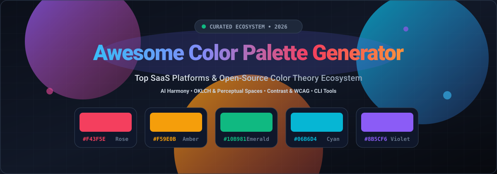

# 🎨 Awesome Color Palette Generator

  

  
  
  
  
  

---

## 🌟 Overview & Ecosystem

Welcome to the definitive, curated directory of **Color Palette Generators**, **Color Theory Engines**, and **Design System Utilities**! Whether you are building brand guidelines, designing WCAG-accessible UI design systems in Figma, or seeking lightweight command-line color extractors for your terminal setup, this guide brings together top SaaS platforms alongside community-loved open-source projects.

> 🔍 **SEO Keywords**: *color palette generator, color scheme generator, color wheel, hex color picker, contrast checker, WCAG accessible colors, AI color generator, OKLCH palette generator, Tailwind CSS palette generator, terminal color schemes, design tokens.*

---

## 📑 Table of Contents

- [📊 Sector Overview & Market Dynamics](#-sector-overview--market-dynamics)
- [☁️ SaaS / Hosted Platforms](#️-saas--hosted-platforms)
- [💻 Open-Source GitHub Projects](#-open-source-github-projects)
- [🤝 How to Contribute](#-how-to-contribute)
- [💖 Support](#-support)
- [📈 Star History](#--star-history)
- [⚠️ Disclaimer](#️-disclaimer)

---

## 📊 Sector Overview & Market Dynamics

The digital design and color tooling market is valued at approximately **$10.1B to $10.5B** globally (growing at ~9% CAGR as part of the broader creative software ecosystem). The sector exhibits a **moderately-to-highly concentrated, tiered structure**: massive enterprise ecosystems (Adobe, Canva) dominate broad design workflows through consolidated suites and aggressive AI integration, while specialized, lightweight palette generation remains fragmented across highly popular indie/micro-SaaS utilities and open-source web projects.

---

## ☁️ SaaS / Hosted Platforms

| Product | Company Scale (Valuation / Revenue) | Description | Pricing | Free Tier Limit |
| :--- | :--- | :--- | :--- | :--- |
| **[Adobe Color](https://color.adobe.com/)** | **~$100B - $146B Market Cap** (~$23.8B - $26.0B Ann. Revenue) | Adobe's color wheel and palette tool integrated with Creative Cloud. | **$9.99/mo** (Adobe Express Premium individual tier; also bundled with CC paid plans) | **Free forever plan**: Unlimited online color wheel generation & CSS/XML export. (Saving themes to Brand Kit / CC Libraries requires 30-day free trial or Premium plan) |
| **[Canva Color Palette Generator](https://www.canva.com/colors/color-palette-generator/)** | **~$32B - $42B Valuation** (~$3.5B - $4.0B ARR) | Palette extraction from uploaded images and color wheel generator within Canva's ecosystem. | **$15/mo** (or $120/yr billed annually for Canva Pro) | **Canva Free plan**: Extracts 1 palette with up to 4-5 dominant colors per upload; Brand Kit palette storage limited to 1 palette of up to 3 colors. (30-day free trial for Canva Pro) |
| **[Coolors](https://coolors.co/)** | **~$1M - $3M ARR (Est.)** (Profitable solo bootstrapped micro-SaaS; 1.7M+ monthly users) | The most popular palette generator with AI, 10M+ schemes, and export tools. | **$5/mo** (or $3/mo billed annually at $36/yr for Coolors Pro) | **Free forever plan**: Save up to 10 palettes, 1 project, 1 collection, and 5 favorite colors; ad-supported; export limited to standard formats. (No trial required) |
| **[Paletton](https://paletton.com/)** | **Bootstrapped Indie / Private** (Classic ad-supported utility, founded 2002) | Classic color scheme designer using RYB color theory with vision simulation. | **$0/mo** (100% Free, display ad supported) | **Free forever plan**: Unlimited access to all wheel schemes, contrast checks, vision simulations, and multi-format exports (HTML, CSS, LESS, XML, ACO). |
| **[Color Hunt](https://www.colorhunt.co/)** | **Bootstrapped Indie / Private** (Curated side project with 1M+ monthly users) | Curated collection of trending 4-color palettes, community-submitted. | **$0/mo** (100% Free, community-driven) | **Free forever plan**: Unlimited browsing, searching, bookmarking, and custom palette submissions; no account or payment required. |
| **[Khroma](https://www.khroma.co/)** | **Bootstrapped Indie / Private** (Independent AI side project by George Hastings) | AI color tool that learns your preferences and generates infinite palettes. | **$0/mo** (100% Free, no paid tier) | **Free forever plan**: Unlimited AI neural network training (50 color choices), infinite personalized palette generation, and unlimited library saves. |
| **[Colormind](http://colormind.io/)** | **Bootstrapped Indie / Private** (Independent AI project by Jack Qiao) | Deep learning palette generator trained on photographs, movies, and art. | **$0/mo** (Free for web and personal API use; commercial API pricing via custom developer contact) | **Free forever plan**: Unlimited web palette generation with daily dataset rotation; REST API free for personal/non-commercial projects without account signup. |

---

## 💻 Open-Source GitHub Projects

Curated list of standout open-source repositories for procedural palette generation, WCAG contrast calculations, perceptual color spaces (OKLCH, HSLuv), and terminal theming—sorted in descending order by GitHub Stars.

- **[chroma.js](https://github.com/gka/chroma.js)**   
  **The ultimate JavaScript color manipulation library.** Powers countless web color pickers and generators. Supports color scale generation, Bezier interpolation, perceptual lightness correction, and conversions between RGB, HEX, HSL, LAB, LCH, and OKLCH color spaces.

- **[pywal](https://github.com/dylanaraps/pywal)**   
  **The legend of terminal palette generation.** Generates full 16-color schemes dynamically on the fly from wallpapers or images, exporting themes across terminals, window managers, GTK themes, and system interfaces.

- **[leonardo](https://github.com/adobe/leonardo)**   
  **Adobe's contrast-based color system generator.** An open-source tool for creating adaptive, accessible UI color palettes based on targeted WCAG contrast ratios and perceptual color spaces.

- **[tints.dev](https://github.com/SimeonGriggs/tints.dev)**   
  **11-color palette generator and API for Tailwind CSS.** Generates perfectly weighted 50–900 tint palettes with smooth contrast curves and instant Tailwind configuration exports.

- **[poline](https://github.com/meodai/poline)**   
  **Esoteric palette generator micro-library.** Generates enigmatic, harmonized palettes by interpolating HSL colors across geometries in cartesian space.

- **[hellwal](https://github.com/danihek/hellwal)**   
  **Blazingly fast C palette engine.** A Pywal-like color scheme extractor and template engine rewritten in pure C for near-instant execution on modern Linux setups.

- **[palx](https://github.com/jxnblk/palx)**   
  **Automatic algorithmic UI color palette generator.** Feed Palx a single brand hex code and it algorithmically derives a complete spectrum of matching, harmonious tints and shades for web UIs.

- **[Rickrack](https://github.com/eigenmiao/Rickrack)**   
  **Harmonious Python-based color synthesizer.** Provides rich desktop and programmatic generation tools for multi-harmony color schemes, color wheels, and color theory formulas.

- **[lutgen-rs](https://github.com/ozwaldorf/lutgen-rs)**   
  **High-performance LUT generator in Rust.** Interpolates arbitrary and popular color palettes (Catppuccin, Gruvbox, Nord, Tokyo Night) and transforms images and wallpapers to match those schemes.

- **[Color Hunter](https://github.com/aprogramq/color-hunter)**   
  **Terminal-native palette generator in Rust.** Generates harmonious palettes using OKLCH and OKHSL with sRGB gamut mapping. Features Vim keybindings, 100-palette history, and clipboard export to CSS, SCSS, Tailwind, and SVG.

- **[Coolors Clone (evergreenx)](https://github.com/evergreenx/coollors)**   
  **Full-stack Coolors clone.** Built with Next.js, Supabase, Shadcn UI, Tailwind CSS, and Clerk Auth. Includes database-backed palette saving and export features.

- **[Brand Color Palette Generator](https://github.com/bivex/brand-color-palette-generator)**   
  **WCAG-compliant brand generator.** Built with Bun, Semantic UI, and Chroma.js. Delivers 13 harmonic schemes, 16 aesthetic brand presets, live UI previews, and Colormind AI integration.

- **[Coolors Clone (nisargkavi)](https://github.com/nisargkavi/coolors-clone)**   
  **Next.js practice implementation.** A clean starter implementation exploring frontend color generation, lockable swatches, and scheme variations in Next.js.

- **[Color Magic](https://github.com/moeezahmad-tech/Color-Magic)**   
  **PHP-based palette explorer.** Features 150+ curated palettes, image extraction, hex-to-name lookup, and gradient browsing built with PHP and Tailwind CSS.

---

## 🤝 How to Contribute

Contributions make the open-source community thrive! Follow these steps to submit a tool or project:

1. 🍴 **Fork the repo** to your own account.
2. 🌿 **Create a branch**: `git checkout -b feat/add-new-palette-tool`
3. 📝 **Add your entry** under the appropriate section following the existing table or list format.
4. ✨ **Include**: Product/Repo name, live link, 1–2 sentence factual summary, pricing/free tier details (for SaaS) or GitHub star badge (for OSS).
5. 🚀 **Submit a Pull Request** with a concise description of why this tool belongs here.

---

## 💖 Support

If you found this curated list helpful for choosing colors, building UI themes, or discovering new open-source projects, please consider supporting the project:

- ⭐ **Star this repository** to help others discover it on GitHub!
- 🍴 **Fork and share** it with fellow designers, developers, and creators.
- ☕ **Buy me a coffee**: Support ongoing curation and maintenance via the [GitHub Sponsors Dashboard](https://github.com/sponsors/ishandutta2007).

---

## 📈 Star History

---

## ⚠️ Disclaimer

- This repository is a **community-curated index** — entries do not imply direct endorsement.
- **Free tiers vary in scope**: Coolors allows up to 10 saved palettes and 5 favorite colors on a free plan, while Canva limits free users to 1 palette of up to 3 colors. Tools like Paletton, Color Hunt, and Khroma remain entirely free.
- **Always verify third-party pricing & API terms** on official websites before deploying tools in commercial production workflows.
